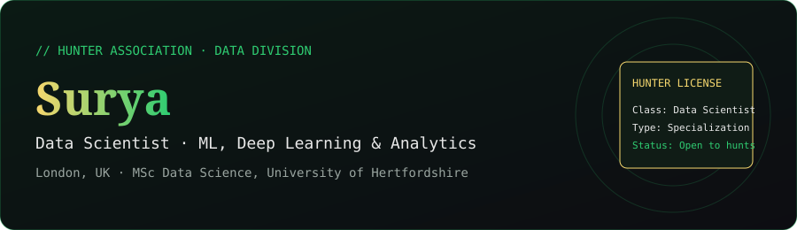
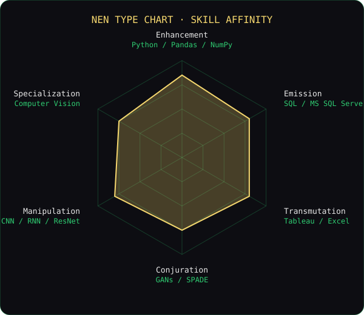

## 🪪 Hunter License

| | |
|---|---|
| **Name** | Leela Sai Surya Peela |
| **Class** | Data Scientist |
| **Base** | London, UK |
| **Guild** | University of Hertfordshire — MSc Data Science |
| **Specialty** | Machine learning, deep learning, analytics & BI |

> *"The fun is in the hunt."* — I build AI-powered solutions and turn complex data into clear business impact.

## 🔮 Nen Type Chart

## 🧰 Hunter Gear

## 🏹 S-Rank Missions (Projects)

| Mission | What it does | Jutsu used |
|---|---|---|
| **Style Synthesis: AI Dress Try-On** *(Mar 2024)* | Customer uploads a photo, picks clothes, and sees how they'd fit. Pipeline: cloth masking (U-Net), pose estimation (MobileNet), segmentation (XceptionNet), DensePose (ResNet50 + FPN), HR-VITON (Conditional GAN + SPADE) | TensorFlow, Keras, GANs |
| **Cardiac Arrhythmia Prediction** *(Dec 2023)* | Predicts heartbeat type from ECG images with a ResNet model | Deep Learning, ResNet |
| **Customer Market Analysis** *(Oct 2023)* | Tableau dashboard with 8 visualisations; analysed 8,000 transaction rows to find 3 customer categories, 2 market strategies and 5 KPIs | Python, Tableau |
| **Automated Employee Reporting** *(Aug 2023)* | Automated reporting with SQL + Excel VBA, cutting data processing time by 25% | SQL, Excel VBA |
| [Statistics & Trends](https://github.com/peelaleelasaisurya20/Statistics-and-Trends_Assignment) | Statistics and trends in global suicide rates | Python, Jupyter |
| [Clustering & Fitting](https://github.com/peelaleelasaisurya20/Clustering-and-Fitting_23088635) | Clustering and curve-fitting analysis | Python, Jupyter |

## 📜 Hunter Exam Log

- 🔄 **MSc Data Science** — University of Hertfordshire (current)
- ✅ **AI/ML Virtual Internship** — AWS Academy (Jan–Mar 2024)
- ✅ **AI Virtual Internship** — Google (Jul–Sep 2023): CNNs, RNNs, regularisation
- ✅ **Virtual Internship** — APSSDC Indo Euro Synchronization (Mar–Aug 2022): data mining, feature selection, classifiers

## 📡 Contact Hunter

Hunter × Hunter inspired · original artwork · not affiliated with the series

